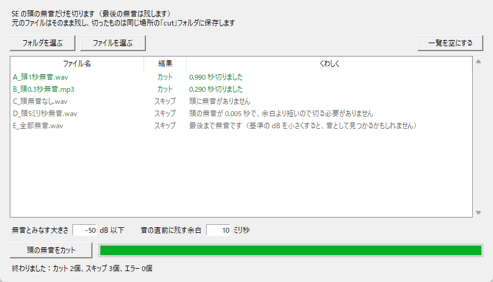

# SE頭無音カット

ダウンロードした SE（効果音）素材の、頭（最初）の無音だけを自動で切るアプリです。最後の無音は残します。フォルダごと、まとめて処理できます。



## できること
- フォルダを選ぶと中の音声ファイルを全部、ファイルを選ぶと選んだものだけを処理します（両方を混ぜても大丈夫です）
- ファイルやフォルダは、ボタンで選ぶほか、画面にドラッグ＆ドロップしても入れられます（音声ではないファイルは入れません）
- 対応する形式：WAV・MP3・OGG・FLAC・M4A・AIFF
- 元のファイルは書きかえず、同じ場所に「cut」フォルダを作って、同じ名前で保存します
- 切る必要がないファイルは、何もせずスキップします
  - 頭に無音がない／頭の無音が余白より短い／最後まで無音／cut フォルダに同じ名前がある
- 結果は表で、ファイルごとに「カット・スキップ・エラー」と理由を色分けして出します
- 画面で変えられる設定
  - 無音とみなす大きさ（はじめは -50dB）
  - 音の直前に残す余白（はじめは 10ミリ秒）

## 工夫したところ
- **音の出だしを守る**：SE は出だしが大事なので、ぴったりで切らず、音の直前にわずかな余白を残します
- **音質を落とさない**：WAV は元と同じ形式（24bit など）、MP3 は元と同じビットレートで保存します。切る必要がないファイルは作り直しません
- **前の結果を消さない**：cut フォルダに同じ名前があるときは、上書きせずスキップします
- **おかしなファイルを見分ける**：壊れたファイル、音声ではないファイル、音のない動画、保存できない場所などは、理由を書いた「エラー」にして、次のファイルへ進みます
- **画面が固まらない**：処理は別のスレッドで動かし、進み具合はキューで画面に渡します

## 使い方
### 必要なもの
- Python 3（3.13 で確かめました）
- [ffmpeg](https://ffmpeg.org/)（動画や音声を扱う道具。`ffmpeg` と `ffprobe` が使える状態にしておきます）
- tkinterdnd2（ドラッグ＆ドロップ用の部品）

```
pip install -r requirements.txt
```

### 起動

```
python app.py
```

`sample` フォルダのお試し用 SE（4つ）で、すぐに試せます。
- `1_チャイム_頭0.5秒無音.wav`・`2_爆発_頭1秒無音.mp3`：頭の無音が切れます
- `3_足音_頭無音なし.wav`：頭に無音がないので、スキップされます
- `4_風_頭に小さなノイズ.wav`：頭に小さなノイズがあります。-50dB ではスキップ、-40dB にすると切れます

### 画面なしで使う

```
python trim_head.py ファイルかフォルダ [ファイルかフォルダ ...] [--db 基準dB] [--margin 余白ミリ秒]
```

### exe にする（Windows）
[PyInstaller](https://pyinstaller.org/) を使うと、ダブルクリックで開ける exe にできます。exe の中に ffmpeg は入らないので、使うパソコンに ffmpeg が必要です。

```
pip install pyinstaller
python -m PyInstaller --onefile --windowed --name se-head-trimmer --collect-all tkinterdnd2 app.py
```

`dist` フォルダに `se-head-trimmer.exe` ができます。

## ファイル
- `app.py`：画面（ボタン、ドラッグ＆ドロップ、一覧の表、設定、進み具合）
- `trim_head.py`：切る部分（無音を見つける、ffmpeg で切る、まとめて処理する）
- `requirements.txt`：必要な Python の部品
- `sample/`：お試し用の SE
- `images/screenshot.png`：README の画面写真

## 使ったもの
- Python、tkinter、tkinterdnd2、ffmpeg、PyInstaller
- Claude：1ステップずつ一緒に作り、毎回動かして確かめました
